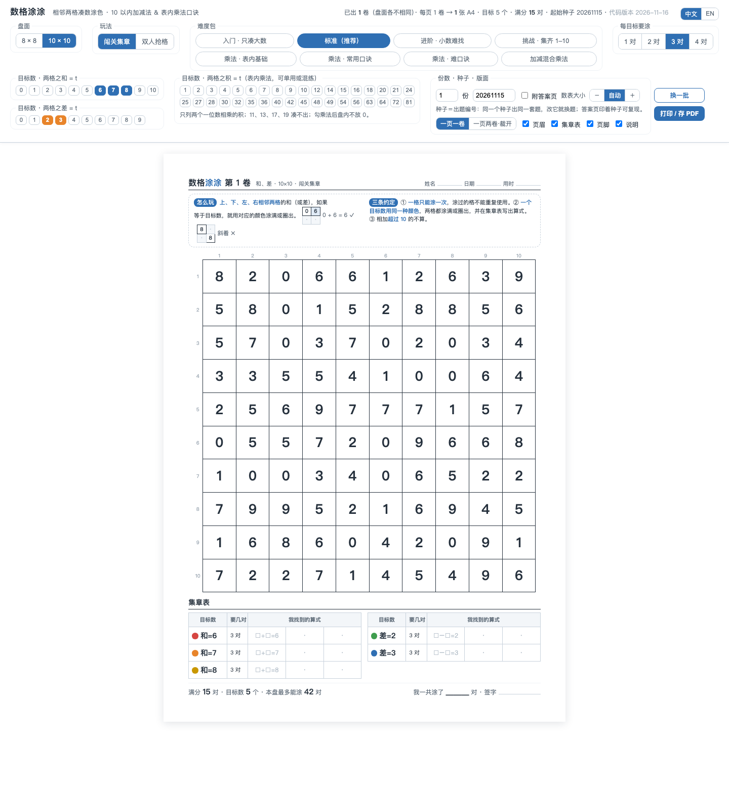

# 数格涂涂 · Number Grid Paint

面向一年级（含表内乘法阶段）的**数学游戏卷生成器**。产出一份单文件、离线、可打印的
A4 HTML：浏览器打开即用，不联网、不依赖任何库，界面与纸面中英双语可切。

源码仓库：<https://github.com/seahp/number-grid-paint>（issue 提在那边；
更新记录见 `CHANGELOG.md`）。

## 成品长什么样



图里那一卷是 `?size=10&seed=20261115&sum=5,6,7,8&diff=2,3&quota=3` 直接生成的，
集章表里已经带上算式提示。想看别的配置，把地址栏参数换掉就行（全表见 `README.md`）。

## 何时使用

- 要"出一张数学涂色游戏""相邻两格凑数"的课堂活动纸
- 要练 10 以内加减法的**和/差**，或表内乘法**积**，或三者混排（孩子先判断用哪种运算）
- 要一次出多份不同题目的卷子（1–6 份），或一张 A4 出两卷裁开
- 要双人课堂对战版（轮流占格，比谁涂得多）
- 要可复现的题（同种子同题），并附老师用的答案页
- 要英文课堂用的版本（本地化措辞，不是逐字翻译）

## 核心文件

| 文件 | 作用 |
|---|---|
| `assets/数格涂涂_生成器.html` | **主产物**。内核（出题+校验）+ 界面 + 版面解算器 + 打印样式 + 双语字典，全在这一个文件 |
| `scripts/verify.mjs` | 独立数学校验。抽取 HTML 里的 KERNEL 段运行，76 项断言 |
| `scripts/env.py` | 其余开发脚本的路径解析（`GRIDPAINT_SRC` / `GRIDPAINT_BROWSER`），仓库布局与技能包布局都认 |
| `scripts/size_probe.py` | 144 版面组合 × 语言：不溢出、不折行、单元不顶格 |
| `scripts/width_probe.py` | 窗口多宽都解出同一个格子（缩放比折算） |
| `scripts/i18n_probe.py` | 双语：未替换占位符 / 英文单复数 / 漏翻 / 撑爆列 |
| `scripts/pdf_check.py`·`pdf_export.py` | 打印回归（数页数、查空白页）与样张导出 |
| `scripts/shot.py` | 屏显态截图（详情页顶部那张成品图就是用它的 `all` 模式截真实页面得到的；市场包不收图片，所以那张图存在源码仓库里，文档直接引它的绝对 URL） |
| `scripts/gap_probe.py`·`half_probe.py` | 量各块落在版心哪一段 / 一页两卷的半页量测 |
| `scripts/doc_check.py` | **文档 ↔ 实际文件一致性**：文档里每条命令和路径，在对应布局下必须真实存在 |
| `scripts/leak_scan.py` | **发布前泄露与脱敏审查**：`git push` / 市场上传 / `publish` 之前必跑，退出码 0 才出门（另有一份"只有作者知道不能公开什么"的名单词表，只留在开发机，不进任何包） |
| `references/rules-and-generation.md` | 出题口径与数学红线（**改内核前必读**） |
| `references/layout-solver.md` | 版面解算器：格子多大是怎么量出来的 |
| `references/i18n.md` | 双语架构与加文案流程 |
| `references/verification.md` | 校验脚本清单与交付前整套 |
| `references/publishing.md` | 打包与上架：谁进哪个包、两个平台的差别、出门前审查、发布后回扫 |
| `CHANGELOG.md` | 更新记录 |

> 路径说明：本表按**技能包**目录写。放进 GitHub 仓库时主产物就在仓库根的
> `数格涂涂_生成器.html`，命令里的 `assets/` 前缀去掉即可，其余路径不变。
> `scripts/env.py` 与 `scripts/verify.mjs` 两种布局都能自动认，不用设环境变量。

## 工作流

### 1. 直接交付（最常见）

把 `assets/数格涂涂_生成器.html` 复制到用户工作区，用浏览器打开。老师自己点
「换一批」「打印 / 存 PDF」。不需要装任何东西。

```
cp assets/数格涂涂_生成器.html ~/Desktop/数格涂涂_生成器.html
```

### 2. 按用户偏好预置默认值

改 HTML 里的 `var S = {...}` 初始值，省得每次手点：

```js
var S={size:10,mode:'quest',sum:[6,7,8],diff:[2,3],mul:[],quota:3,copies:1,seed:20261111,
  withAns:true,rule:true,hdr:true,stamp:true,foot:true,per:1,cellAdj:0,lang:'zh'};
```

也可以不改文件，直接用地址栏参数生成一条可分享的链接（适合"给我 4 份、一页两卷、
只练 6、7、8 的和"这类要求）：

```
?lang=en&size=10&per=2&copies=4&sum=6,7,8&diff=2,3&quota=3&seed=20261111&ans=1&hdr=1&stamp=1&foot=1&rule=1
?p=std        # 难度包：easy std mid hard m1 m2 m3 mix
```

参数全表见 `README.md`。

### 3. 批量出卷

无头导出（不需要人点，适合定时任务或一次出几十份）：

```
python3 scripts/pdf_export.py '?size=10&copies=4&per=2&lang=zh&seed=20261111' <输出目录>/课堂4份.pdf
python3 scripts/pdf_export.py '?p=m3&size=8&lang=en&seed=777' <输出目录>/multiplication.pdf
```

输出目录自己定，不存在会创建；仓库里习惯用 `out/`。无头导出固定 1440px 视口，
避免窄窗口预览缩放干扰量测。要浏览器：Edge / Chrome 任一，`env.py` 会自动找。

### 4. 改玩法 / 改题目口径

先读 `references/rules-and-generation.md`，改 KERNEL 段，然后：

```
node scripts/verify.mjs                       # 数学红线必须 76/0
python3 scripts/size_probe.py --lang zh
python3 scripts/size_probe.py --lang en
```

内核文案要用 `KM('中文','English')` 包，**不要**在 KERNEL 里调 `T()`（KERNEL 不依赖外面的 `S`）。

### 5. 改版面（字号、栏宽、块间距）

先读 `references/layout-solver.md`。格子大小是**实测解出来的**，不是查表——
所以 `node --check` 通过不代表版面没问题，必须跑浏览器探针：

```
python3 scripts/size_probe.py --lang zh   && python3 scripts/size_probe.py --lang en
python3 scripts/width_probe.py 1440 760 400 lang=zh
python3 scripts/pdf_check.py
python3 scripts/gap_probe.py 10 6,7,8       # 各块落在版心哪一段
python3 scripts/half_probe.py '?size=10&per=2'   # 一页两卷
```

红线：`异常 0`、`单格横向顶出去的组合 0`、`不一致 0`、`页数`与预期一致。

### 6. 加/改双语文案

先读 `references/i18n.md`。三条硬规矩：

1. `L10N_RAW` 每个 key 两条，顺序固定 `[中文, English]`；
2. 英文带数字的要说单复数，用 `{z}` + `PL(n)`；
3. `applyLang()` 必须在 `sync()` 之前跑（否则 ➕➖ 的手动读数被中文覆盖）。

改完跑 `python3 scripts/i18n_probe.py`（问题 0）。

### 7. 交付前自检（包内就能跑）

```
python3 scripts/doc_check.py          # 文档里每条命令和路径，在当前布局下都得真实存在
node scripts/verify.mjs               # 数学红线 76/0
python3 scripts/leak_scan.py          # 泄露与脱敏审查；退出码非 0 就别往外发
```

要重新打包上架（出仓库目录、两个市场的 zip）是开发仓库里的事，
见 `references/publishing.md`。

```
python3 scripts/make_dist.py --strict   # 仓库里跑：出 dist/ 三份物料（技能包里不要跑）
python3 scripts/leak_scan.py dist       # 扫真正要发出去的那份 + 两个 zip 的包内字节
```

流程、两个平台的差别、发布后怎么把线上那份拉回来重扫，见 `references/publishing.md`。

## 关键口径（别改错）

* **和 ≤ 10**：相加超过 10 不算，纸上也这么写。
* **一格只能用一次**：所以 8×8 最多 32 对、10×10 最多 50 对，超了直接拒答并说明原因。
* **积必须是两个一位数之积**：11 / 13 / 17 / 19 这类永远凑不出，禁止选。
* **勾了乘法，盘内不含 0**：0 乘任何数都是 0，会留一堆死格。
* **同种子 = 同题**，种子印在答案页页眉，老师抄下来就能找回同一套题。
* **版面按 A4 实测**：目标数变少或勾掉页眉/集章表/页脚/说明，空出来的高度真的还给盘面。

## 许可与署名

CC BY-NC-SA 4.0（署名 / 非商业 / 相同方式共享），全文见 `LICENSE.txt`。
转发或改编时请保留 HTML 顶部的许可证注释，并注明出处。
